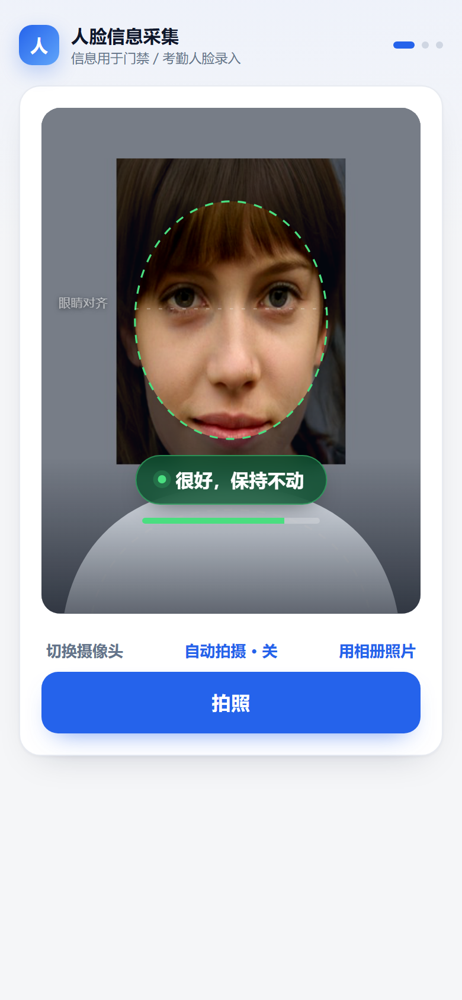
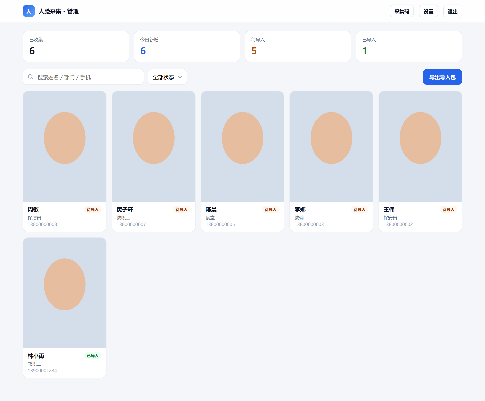
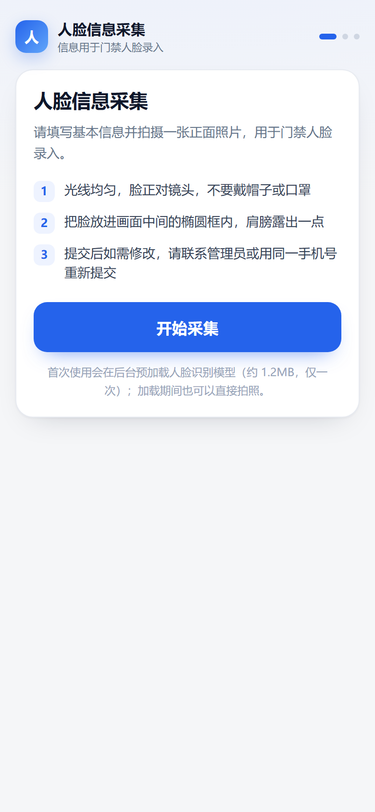
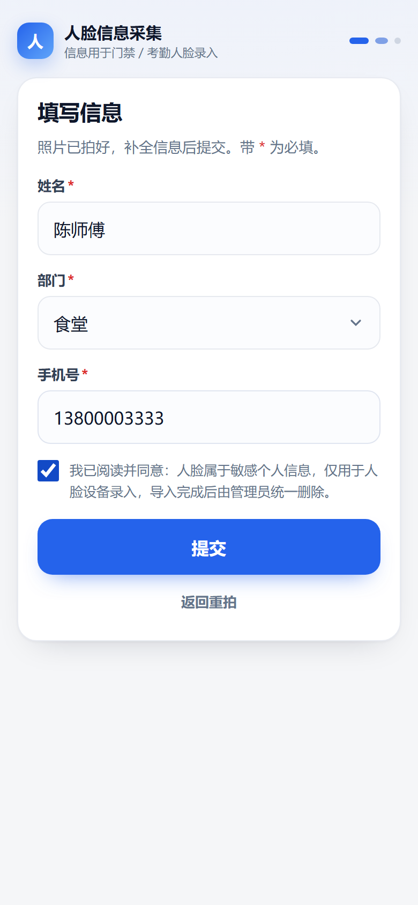
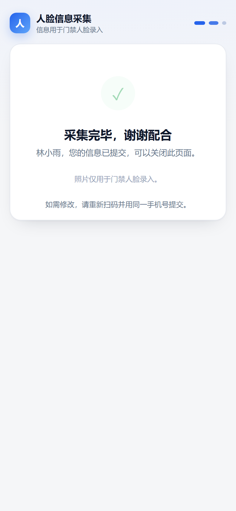
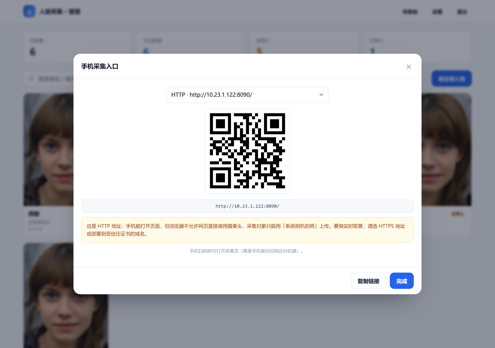
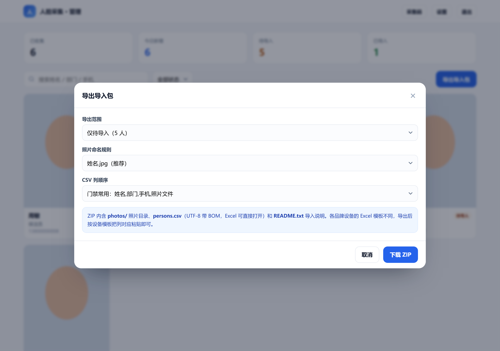
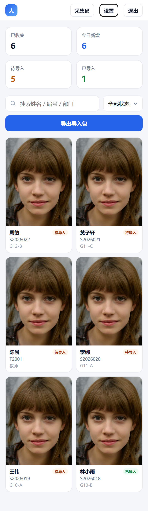

# face-collect · 手机人脸采集 + 设备导入包

给一群人（教职工 / 教辅 / 保安 / 保洁 / 食堂）在手机上自助采集"人脸照片 + 姓名 + 部门 + 手机号"，管理员在后台检查、清理，然后一次性导出 **照片目录 + CSV**，再按人脸设备的模板导入设备。

零依赖：只用 Node 内置模块，`node server.js` 即可跑；数据全部落在本机 `data/` 目录。

## 界面预览

| 手机采集页 | 管理后台 |
| --- | --- |
|  |  |

<details>
<summary>更多截图</summary>

| | |
| --- | --- |
|  |  |
|  |  |
|  |  |

</details>

## 快速开始

```powershell
cd D:\YIN-PROJE\output\face-collect
node server.js
```

Windows 上也可以直接双击 **`start.cmd`**。

启动后终端会打印：

- 采集页 `http://localhost:8090/`
- 管理页 `http://localhost:8090/admin`
- 首次启动会生成管理员密码，保存在 `data/admin-password.txt`（也可用环境变量 `ADMIN_PASSWORD=xxx` 指定）

想换端口：`$env:PORT=9000; node server.js`。

## 手机怎么打开

同一局域网内，手机访问 `http://<电脑IP>:8090/`。

⚠️ 但手机浏览器**只允许 HTTPS 页面直接调用摄像头**（`getUserMedia` 的安全上下文限制）。所以：

| 场景 | 结果 |
| --- | --- |
| `http://局域网IP:8090` | 页面能开，但相机按钮不可用；可点「用系统相机拍照」走系统相机上传 |
| `https://域名`（受信任证书） | 完整体验：实时取景、椭圆引导、3 秒倒计时、清晰度/亮度提示 |
| `https://局域网IP:8443`（自签证书） | 能进页面，但需要手动跳过证书警告；部分浏览器仍会拒绝摄像头 |

最省事的正式方案：把应用放到已有 HTTPS 域名下（见下面「部署到服务器」），用二维码发链接。

本地想先试实时取景：`powershell -ExecutionPolicy Bypass -File scripts\make-cert.ps1`，重启后访问 `https://<IP>:8443`。
证书按本机 IP 生成，换机器或换网段后重新跑一次脚本即可（`certs/` 已 gitignore）。

## 采集端（手机）

1. 打开链接 → 填访问码（管理员在设置里开启时）→ 开始采集
2. 授权摄像头 → 把脸放进遮罩里的头部区域
3. 画面下方实时提示：`靠近一点` / `移到框中间` / `头回正（偏 6°）` / `正对镜头`；左侧小字标注「眼睛对齐」虚线
4. 对齐后椭圆变绿、底部进度条走满 → 自动抓拍（也可关掉「自动拍摄」手动按快门）
5. 成片会**按人脸自动居中**、**按眼睛连线自动转正**，固定输出 480×640，再检查亮度/清晰度
6. 填姓名、部门（下拉：教职工 / 教辅 / 保安员 / 保洁员 / 食堂）、手机号 → 勾选同意 → 提交
7. 提交后显示「采集完毕，谢谢配合」，员工可关闭页面（要改信息就重新扫码、用同一手机号覆盖）

同一手机号重复提交会提示是否覆盖旧记录（保持一条最新）。

### 自动拍摄的判据

连续 **8 帧**（约 1 秒）全部满足才触发；任一条不满足就清零重来。手动按快门不受这些限制。

| 判据 | 阈值 | 提示 |
| --- | --- | --- |
| 画面里恰好一张脸 | = 1 | 多张脸 → `画面里有多个人` |
| 脸高占取景窗 | 26% ~ 75% | `靠近一点` / `稍微退后一点` |
| 脸中心 | 水平 0.5±0.10、垂直 0.45±0.10 | `移到框中间` |
| 左右歪头 roll | ≤ 8° | `头回正（偏 6°）` |
| 低头/仰头（鼻尖相对眼—下巴的上下比例） | 0.16 ~ 0.62（几何估算） | `头摆正（别低头/仰头）` |
| 左右转头 yaw（鼻尖偏移 ÷ 眼距） | ≤ 0.26 | `正对镜头` |
| 闭眼（EAR 眼睛纵横比） | ≥ 0.19 | `请睁开眼睛` |
| 口罩（下半脸非肤色浅色占比） | ≤ 45% | `疑似戴口罩，请摘下后重拍` |
| 墨镜（眼部条带深色占比） | ≤ 68% | `疑似戴墨镜，请摘下后重拍` |
| 亮度 | 52 ~ 220 | `光线太暗` / `画面过亮` |
| 清晰度（梯度均值） | ≥ 4 | `画面偏模糊，请拿稳手机` |

### 人脸识别模型

实时引导用的是 **face-api.js**（MIT）的 TinyFaceDetector + 68 点关键点，文件放本地 `public/vendor/faceapi/`，不联网：

- 进页面就开始预加载（不用等到点「开始采集」），加载期间仍可直接手动拍照
- 首次传输约 **1.2MB**（JS 648KB + 检测模型 190KB + 68 点模型 350KB + manifest），之后走浏览器缓存（`immutable`，一年）
- 一个员工一台设备只下一次；100 人约 120MB 流量
- 加载失败（老浏览器、断网、被拦截）会自动降级为**手动模式**：遮罩还在，成片按画面中间裁 3:4，不影响提交

## 管理端

- 统计：已收集 / 今日新增 / 待导入 / 已导入
- 搜索姓名、部门、手机；按状态筛选
- 点卡片看大图、改信息、删除、标记「已导入」
- 「采集码」：直接弹出二维码和链接，发给采集对象
- 「设置」：标题、隐私说明、部门下拉选项、必填开关、访问码、开放/关闭提交、改密码

## 导出与导入设备

点「导出导入包」，选择范围 / 照片命名 / CSV 列顺序，得到 ZIP：

```
face-export-20261020-1530.zip
├─ photos/            480×640 JPG，默认按「姓名.jpg」命名（同名自动加 -2）
├─ persons.csv        UTF-8 带 BOM，Excel 双击不乱码
├─ data.json          完整字段备份
└─ README.txt         导入说明
```

导入设备的一般流程：

1. 打开设备厂商的客户端 / Web 后台（海康 iVMS-4200 / HikCentral、大华 SmartPSS 等）
2. 找到「人员管理 → 批量导入」，**下载该型号自带的 Excel 模板**
3. 把 `persons.csv` 的列按模板表头粘贴过去（列名、必填项、日期格式各型号不同）
4. 照片按模板要求命名后一起导入；只支持 U 盘的设备，把 `photos/` 拷到其指定目录

> 设备模板差异很大，本工具不假装知道每一款的列名。CSV 是"原料"，最终以设备模板为准。
> 如果设备支持 ISAPI / HTTP API，也可以改成直接推送（海康见 `Shaykhnazar/hikvision-isapi`，MIT），目前版本只做文件导出。

## 目录结构与数据

```
face-collect/
├─ server.js              零依赖 HTTP/HTTPS 服务
├─ public/
│  ├─ index.html          手机采集页
│  ├─ admin.html          管理后台
│  ├─ vendor/qrcode.js    MIT 二维码库（本地内置，不联网）
│  └─ vendor/faceapi/     MIT 人脸检测 + 68 点关键点（约 1.2MB，含模型）
├─ scripts/
│  ├─ make-cert.ps1       生成本地自签证书
│  └─ start.ps1           启动脚本
├─ data/                  ← 所有敏感数据都在这里，已 gitignore
│  ├─ records/*.json      每条记录
│  ├─ photos/*.jpg        人脸照片
│  ├─ config.json         设置 + 密码哈希
│  ├─ audit.jsonl         提交/修改/删除/导出审计
│  └─ admin-password.txt  首次生成的明文密码
└─ certs/                 ← 自签证书（可选）
```

备份：直接复制整个 `data/`。迁移服务器：`data/` + `certs/` 一起拷走即可。

## 隐私与安全（重要）

人脸是**敏感个人信息**。这个工具做了这些：

- 采集页必须勾选同意条款才能提交，条款文字可在设置里改
- 后台密码 + HttpOnly 会话 Cookie；登录失败限速
- 照片只能通过登录后的接口读取，静态目录不暴露 `data/`
- 审计日志记录提交、覆盖、修改、删除、导出
- 删除记录时照片一并删除

还需要你做的：

- 上线前告知采集目的、范围、保存期限，并取得本人/监护人同意（未成年人尤其）
- 导入设备完成后尽快删除本工具里的原始数据（导出后清空记录）
- 不要把 `data/` 放进公开网盘或代码仓库
- 正式环境走 HTTPS，别把管理密码设成 123456

## 部署到服务器（可选）

```bash
# 服务器上
mkdir -p /opt/face-collect && cd /opt/face-collect
# 上传本目录（不含 data/）
npm install -g pm2   # 如果还没有
pm2 start server.js --name face-collect
pm2 save
```

nginx 反代（用现成证书）：

```nginx
server {
    listen 443 ssl;
    server_name face.example.com;
    ssl_certificate     /etc/letsencrypt/live/face.example.com/fullchain.pem;
    ssl_certificate_key /etc/letsencrypt/live/face.example.com/privkey.pem;

    client_max_body_size 12m;

    location / {
        proxy_pass http://127.0.0.1:8090;
        proxy_set_header Host $host;
        proxy_set_header X-Forwarded-For $proxy_add_x_forwarded_for;
        proxy_set_header X-Forwarded-Proto $scheme;
    }
}
```

内网没有域名时，也可以用学校已有的内网 CA（mkcert）给这台机器签一张证书。

## 配置

大部分在后台「设置」里改。`data/config.json` 里还有：

- `photoWidth` / `photoHeight`：默认 480×640，按设备要求改
- `adminPasswordHash`：删掉它再重启会重新生成密码

环境变量：`PORT`（默认 8090）、`HTTPS_PORT`（默认 8443）、`ADMIN_PASSWORD`、`FC_DATA_DIR`（把数据放别处）。

## 已知限制

- 未做活体检测，无法防止"拿照片对着镜头"；眨眼检测只用于"别闭眼"，不构成活体证明
- 左右歪头（roll）会做旋转校正；低头/仰头（pitch）只检测不校正，靠提示让人自己摆正
- 口罩/墨镜是**像素启发式**判断（不是分类模型）：深色胡须、浓眉、强阴影可能误报，浅色口罩+逆光可能漏报；误报时仍可手动按快门
- 低头/仰头是用 68 点几何比例粗判（不是 3D 姿态），只能拦明显的前倾/后仰，阈值取得比较宽
- 闭眼用 EAR（眼睛纵横比），戴眼镜/眯眼时可能偏保守
- 模型首次加载约 17MB，弱网环境下会慢；加载失败会自动降级为手动模式
- 自签 HTTPS 在部分手机浏览器上仍可能禁止摄像头
- CSV 是通用列，最终导入仍需按设备模板调整；不做 Excel 二进制模板导出
